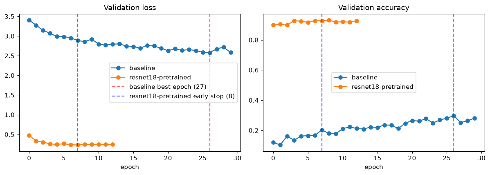
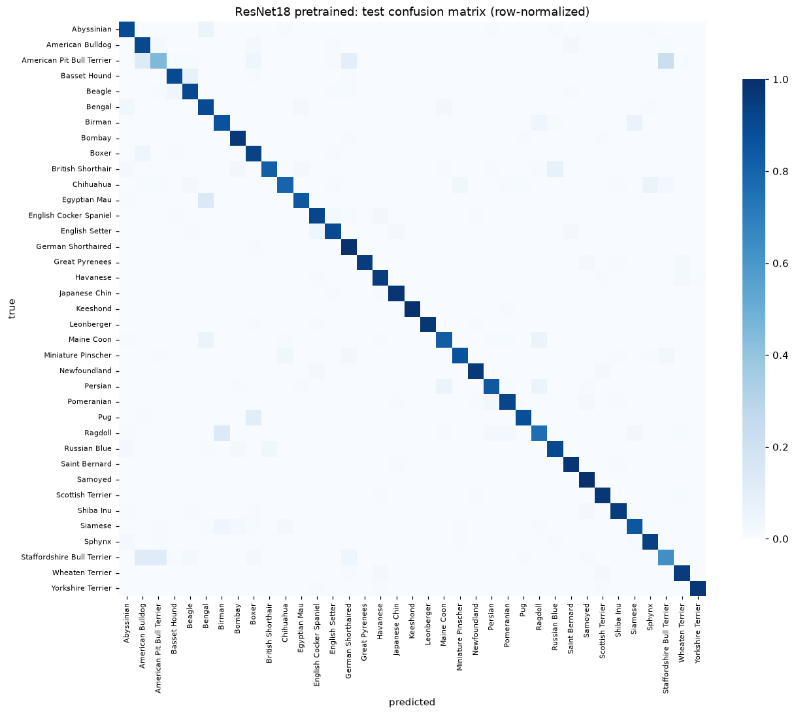

# Deep Learning Systems Analysis Report - Cat and Dog Breed Classification

Author: Francisco Mateus

Dataset: Oxford-IIIT Pet (Parkhi et al., 2012)

Project: Deep Learning capstone

Program: Master's in Artificial Intelligence, Udacity

Date: 2026-11-05

## Overview

This project compares two convolutional neural networks, classifying 37 cat and dog breeds using the Oxford-IIIT Pet dataset (Parkhi et al., 2012).
This involved training a small CNN from scratch and fine-tuning an ImageNet-pretrained ResNet18 (He et al., 2015), using the same data split and preprocessing.
For the ResNet18 result, it reached a test accuracy of 0.8940, vs a 0.2044 baseline. This shows a significant improvement, although the comparison does not separate the benefit of pretraining from differences in model architecture.

## Dataset and Task Description

The data used in this project comes from the Oxford-IIIT Pet dataset (Parkhi et al., 2012), available at https://www.robots.ox.ac.uk/~vgg/data/pets/. This dataset overall contains photographs of cats and dogs with breed annotations, below are its details:

- **total photographs**: 7,349
- **breed labels**: 37, covering cats and dogs
- **training and validation pool** (trainval): 3,680 images
- **test set**: 3,669 images
- **images per breed in trainval**: 93 to 100 (making the classes nearly balanced)

To identify the breed in each photograph, the model needed to distinguish details such as head shape and coat texture. This was challenging because similar breeds can share coat colors, body shapes, and facial features.

A stratified split of the trainval pool was used so that every breed was represented in both the training and validation sets. The dataset's original test set was reserved for final evaluation and was not used for training or tuning.

Images were divided into three sets:

- **training**: 3,129 images, used to update model weights
- **validation**: 551 images, used to monitor training and select the best checkpoint
- **test**: 3,669 images, held out from training and tuning

Baseline CNN and ResNet18 used the following image preprocessing steps and parameters:

- **input size**: 224 by 224 pixels
- **normalization**: ImageNet channel statistics, matching the pretrained weights
- **training augmentation**: random resized crops and horizontal flips
- **validation and test processing**: deterministic resizing and normalization, without random augmentation
- **random seed**: 42, used for the split and training randomness

## Model Architecture and Design Decisions

For the baseline, I used a small CNN with two convolutional blocks and the following structure:

- **convolutional** blocks: each applies convolution, batch normalization, ReLU activation, and max pooling
- **classification head**: fully connected layers with dropout to limit overfitting on the 3,129 training images
- **output layer**: produces 37 scores, one for each breed

Batch normalization and dropout act as regularization here: with few images, the network needs help to keep learning the task instead of fitting its noise.

With only 3,129 training images available, I chose a small baseline to limit model complexity. However, the limited training data meant that overfitting still remained an issue.

For comparison, I used ResNet18 with weights pretrained on ImageNet (He et al., 2015). I replaced its final layer to produce 37 scores, one for each breed, and fine-tuned both the pretrained backbone and the new classification head.

Baseline CNN and ResNet18 were trained using the following settings and stopping criteria:

- **loss function**: cross-entropy with integer class labels
- **optimizer**: Adam
- **learning rate**: 1e-3; ResNet18 replaces it with the two rates described in the next section
- **learning-rate scheduler**: ReduceLROnPlateau, which halves the learning rate when validation loss stops improving
- **early stopping**: training stops after 5 consecutive epochs without an improvement in validation loss (Prechelt, 1998)
- **training limit**: 30 epochs
- **model selection**: the checkpoint with the lowest validation loss is used for testing

## Experimental Comparison

The main question presented in the analysis was whether fine-tuning a pretrained model would perform better than training a small CNN from scratch on the available pet images. From my research, pretraining provides features learned from a larger image collection, some of which can transfer to a new classification task (Yosinski et al., 2014).

During fine-tuning, I used different learning rates for ResNet18's two parts:

- **pretrained backbone**: 1e-4, to make smaller updates to existing features
- **new classification head**: 1e-3, to let the new layer adapt more quickly

The baseline CNN and ResNet18 used the same data split, preprocessing, augmentation, loss function, optimizer, scheduler, stopping criteria, and random seed. Since they used different architectures and learning rates, the accuracy gap cannot be attributed to pretraining alone.

Each model was evaluated on the test set using the checkpoint with the lowest validation loss. The evaluation covered:

- **overall accuracy**: proportion of test images classified correctly
- **macro per-class accuracy**: average recall across all 37 breeds, giving each breed equal weight
- **per-class recall and confusion matrices**: which breeds were missed and which labels were confused

> Note about random guessing: choosing 1 of the 37 breeds at random gives an expected accuracy of about 2.7% (1 in 37). This provides a reference point, but breed-level results are needed to judge whether either model is useful.

## Results and Interpretation

### Test-set performance

On the 3,669 held-out test images:

| Performance measure | Baseline CNN | ResNet18 |
|---|---|---|
| Accuracy | 0.2044 | 0.8940 |
| Macro per-class accuracy | 0.2051 | 0.8934 |

ResNet18 misclassified 389 test images and exceeded the baseline's accuracy by 0.6896. Both models performed above random guessing, but ResNet18 was substantially more accurate. Its overall accuracy and macro per-class accuracy were similar, though some breeds remained much harder to identify than others.

### Training behavior

ResNet18 reached its best validation loss earlier than the baseline. The table below compares their training results:

| Training measure | Baseline CNN | ResNet18 |
|---|---|---|
| Best validation loss | 2.5792 | 0.2321 |
| Epoch with best validation loss | 27 | 8 |
| Final training accuracy | 0.4203 | 1.0000 |
| Final validation accuracy | 0.2813 | 0.9274 |
| Training-minus-validation gap at the final epoch | 0.1390 | 0.0726 |
| Epochs completed | 30 | 13 |
| Reason training ended | Reached the 30-epoch limit | Early stopping after 5 epochs without improved validation loss |

The table's final accuracy values were recorded at the last training epoch. Test results came from the checkpoint with the lowest validation loss.

The baseline reached a training accuracy of 0.4203 and a validation accuracy of 0.2813. This gap suggests some overfitting, while the low accuracy on both sets indicates that the model also struggled to learn the task. These findings apply to this baseline and training setup, not to all models trained from scratch.

**Figure 1.** Validation loss and accuracy by epoch. ResNet18 reaches lower validation loss and higher validation accuracy much earlier than the baseline.

ResNet18 had a smaller training-to-validation accuracy gap (0.0726) than the baseline (0.1390). However, these gaps should be interpreted cautiously: training images were randomly augmented, while validation images were not, so they do not measure overfitting alone.

**Figure 2.** Row-normalized confusion matrix for ResNet18 on the test set. Each row shows how images of one breed were classified; off-diagonal entries are mistakes.

### Per-class accuracy

The table below shows the ten breeds with the lowest ResNet18 recall, alongside the baseline results. Recall is the proportion of images of a given breed that the model classified correctly.

| Breed                         | Baseline | ResNet18 |
|-------------------------------|----------|----------|
| American Pit Bull Terrier     | 0.05     | 0.45     |
| Staffordshire Bull Terrier    | 0.18     | 0.63     |
| Ragdoll                       | 0.28     | 0.76     |
| Chihuahua                     | 0.05     | 0.80     |
| British Shorthair             | 0.27     | 0.82     |
| Maine Coon                    | 0.17     | 0.83     |
| Persian                       | 0.11     | 0.84     |
| Egyptian Mau                  | 0.37     | 0.85     |
| Siamese                       | 0.20     | 0.85     |
| Birman                        | 0.13     | 0.87     |

ResNet18 improved recall for every breed in this table. The largest gains were Chihuahua (0.05 to 0.80) and Birman (0.13 to 0.87), while American Pit Bull Terrier stayed weakest at 0.45.

American Pit Bull Terrier and Staffordshire Bull Terrier remained the weakest classes for ResNet18. The confusion matrix and the notebook's error examples show mistakes between visually similar breeds. This is consistent with the difficulty of fine-grained classification, but it does not prove which visual features caused each error.

## Interpretation for a Non-Technical Audience

The model is a computer program with one job: look at a photo of a cat or a dog and say which of the 37 breeds it is. Nobody wrote rules for that. The program learned by example, the way a person learns to tell two similar breeds apart, by looking at photographs with the correct answer next to them.

That learning used about 3,000 pet photographs, each with its correct breed name. Repeating those same photographs back would prove little, because the program could simply be reciting memorized answers. Its real performance was therefore measured on 3,669 photographs it had never seen.

The main results are:

- the program that started from ImageNet named the correct breed for about 9 out of 10 test photographs
- the program that learned only from this dataset got about 2 out of 10 right
- a few similar-looking breeds stayed difficult even for the better program

The head start is simple: the winning program had already seen millions of general photographs, so it arrived knowing what edges, shapes, textures, and colors look like. Its only new job was telling the 37 pet breeds apart. The other program had none of that background and had to learn all of it, from what a photo is to which breed is which, from this project's 3,000 pet photographs. Still, the result applies to this dataset, and it does not show that such a program can reliably identify mixed breeds or animals outside its 37 labels.

Each answer is a guess based on what the photo shows, not proof of the breed. It can even be wrong with full confidence. For anything that matters, such as adoption listings, veterinary records, or breeding paperwork, a person should confirm the breed before acting on the guess.

## Limitations and Risks

### Limits of the experiment

The main limitations are:

- **single split and seed**: training was not repeated across seeds and no cross-validation was run, so variability across runs is unknown
- **different architectures**: the comparison cannot separate pretraining from differences in network design and capacity
- **limited baseline**: the small CNN is one from-scratch model, not the best performance that from-scratch training could achieve
- **fixed resolution**: resizing to 224 by 224 pixels may remove details needed to distinguish similar breeds
- **limited coverage**: performance on mixed breeds, unfamiliar breeds, and different photographic conditions was not measured
- **inherited bias**: ImageNet pretraining may transfer biases in image coverage and representation that aggregate accuracy does not reveal (Mehrabi et al., 2021)

### Future improvements

The next most useful experiments would be:

- comparing pretrained and randomly initialized ResNet18 models under matched training settings, to better isolate the contribution of pretraining
- repeating training with several seeds or using cross-validation within trainval, keeping the official test set separate
- testing higher-resolution inputs to see whether they improve recall for similar-looking breeds
- comparing freezing early ResNet18 layers with full fine-tuning to assess the tradeoff between adaptation and overfitting
- evaluating a stronger scratch baseline with suitable regularization

The trainval classes already have similar counts, so class balancing is not an obvious first priority. Targeted sampling of difficult breeds could still be tested, but any benefit would need to be measured on validation data.

## Ethical and Responsible Use

The dataset represents a fixed set of breed labels, not the full range of animals and photographs a deployed system would encounter. The pretrained model may also carry biases from ImageNet (Mehrabi et al., 2021). Neither the test accuracy nor the per-class table establishes fairness across settings or populations that were not evaluated.

Responsible use would require:

- **human review**: do not use the predicted label as the sole basis for breed-related restrictions, care decisions, or official records
- **clear scope**: disclose that mixed breeds and animals outside the label set were not evaluated
- **relevant testing**: assess performance on images from the intended setting before deployment
- **error reporting**: show breed-level results and failure examples alongside overall accuracy

The per-class results, the confusion matrix, and the notebook's error examples make the model's weaknesses visible. These are useful checks, but they are not a substitute for deployment-specific evaluation.

## References

He, K., Zhang, X., Ren, S., & Sun, J. (2015). Deep residual learning for image recognition. *arXiv preprint arXiv:1512.03385*.

Mehrabi, N., Morstatter, F., Saxena, N., Lerman, K., & Galstyan, A. (2021). A survey on bias and fairness in machine learning. *ACM Computing Surveys*, 54(6), Article 115. https://doi.org/10.1145/3457607

Parkhi, O. M., Vedaldi, A., Zisserman, A., & Jawahar, C. V. (2012). Cats and dogs. *2012 IEEE Conference on Computer Vision and Pattern Recognition*, 3498-3505.

Prechelt, L. (1998). Early stopping: But when? In G. B. Orr & K.-R. Müller (Eds.), *Neural networks: Tricks of the trade* (pp. 55-69). Springer.

Yosinski, J., Clune, J., Bengio, Y., & Lipson, H. (2014). How transferable are features in deep neural networks? *Advances in Neural Information Processing Systems 27 (NIPS 2014)*.
